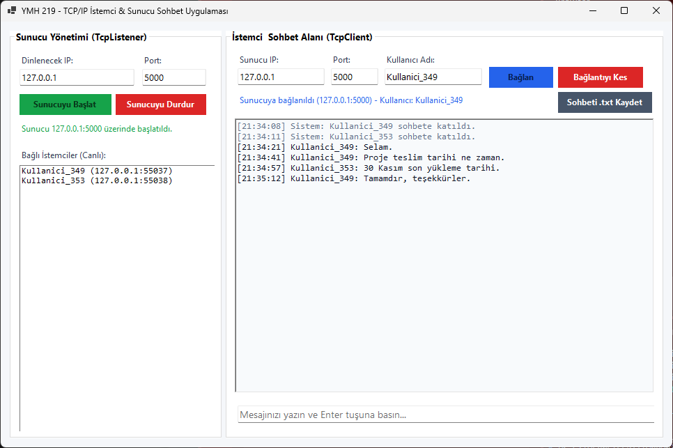
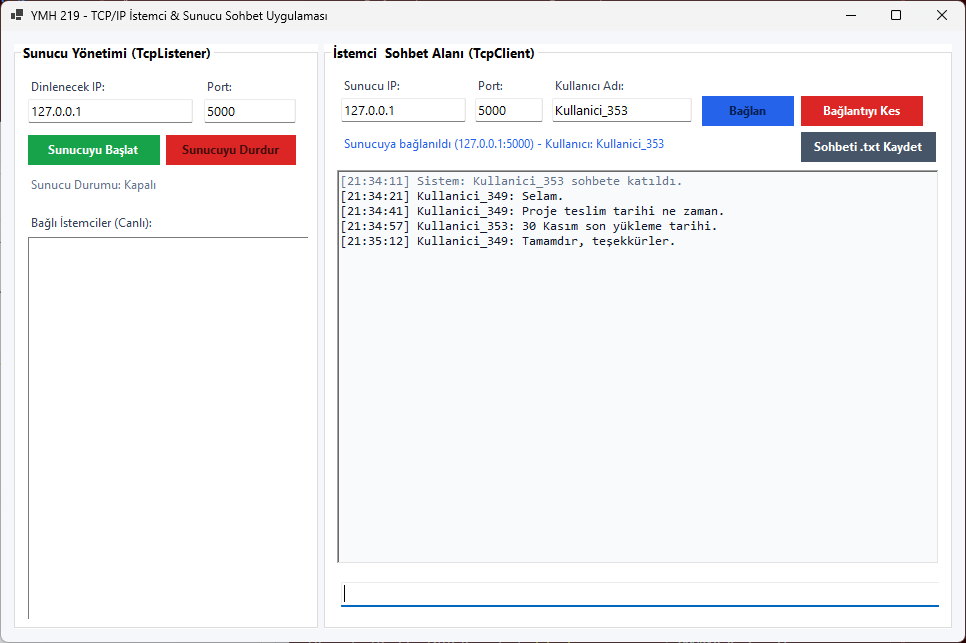

# YMH219 - TCP/IP İstemci & Sunucu Sohbet Uygulaması (ChatApp)

Nesne Tabanlı Programlama (YMH 219) dersi kapsamında .NET 8.0 Windows Forms ve `System.Net.Sockets` kullanılarak geliştirilmiş, tek pencere içinde hem TCP Sunucu (`TcpListener`) hem TCP İstemci (`TcpClient`) çalıştırabilen gerçek zamanlı sohbet uygulamasıdır.

## Öğrenci Bilgileri
- **Ad Soyad:** Selahattin Ali Kılıç
- **Öğrenci No:** 250541036
- **Ders:** YMH 219 - Nesne Tabanlı Programlama

## Kullanılan Teknoloji / NuGet Paketleri ve OOP Mimarisi
- **Platform:** .NET 8.0 Windows Forms (`net8.0-windows`)
- **Ağ Protokolü:** TCP/IP (`TcpListener`, `TcpClient`, `StreamReader`, `StreamWriter`, `async/await`)
- **Harici NuGet Paketi:** Yok (JSON serileştirme için `System.Text.Json`)
- **OOP Mimarisi:**
  - **Interfaces:** `IChatServer` ve `IChatClient` ağ bileşenlerini arayüzler üzerinden soyutlar.
  - **Models:** `ChatMessage` (JSON serileştirme ve `[HH:mm:ss] Kullanıcı: Mesaj` biçimlendirme) ve `ConnectedClientInfo`.
  - **Services & EventArgs:** `ChatServer` (çoklu istemci yönetimi ve broadcast) ve `ChatClient` sınıfları `ChatMessageReceivedEventArgs`, `ClientListChangedEventArgs`, `NetworkStatusEventArgs` olayları üzerinden UI ile haberleşir.

## Kurulum ve Çalıştırma Adımları
```bash
cd YMH219-ChatApp
dotnet build
dotnet run
```
Aynı bilgisayarda test etmek için uygulamadan **iki örnek** başlatın:
1. İlk pencerede `Sunucuyu Başlat` (`127.0.0.1:5000`) butonuna basın ve kendi kullanıcı adınızla `Bağlan` deyin.
2. İkinci pencerede farklı bir kullanıcı adı girerek `Bağlan` (`127.0.0.1:5000`) butonuna basın ve mesajlaşın.

## Uygulamanın Temel Özellikleri
- Tek uygulama üzerinden hem sunucu başlatma hem istemci olarak bağlanma imkânı.
- Sunucu panelinde bağlı istemcilerin canlı listesi (`ListBox`).
- `[HH:mm:ss] Kullanıcı: Mesaj` formatında zaman damgalı mesaj akışı.
- Bağlantı reddi, port meşguliyeti veya ani kopmalarda çökmeden kullanıcıya anlaşılır hata bildirimi (`try-catch`).
- İsteğe bağlı olarak sohbet geçmişini `.txt` dosyasına kaydetme (`SaveFileDialog`).

## Ekran Görüntüleri



## Bilinen Sınırlamalar / Geliştirme Notları
- Mesajlar ağ üzerinden satır sonu (`\n`) ayracıyla JSON paketleri hâlinde iletilir.
- Yerel ağ (`127.0.0.1` veya LAN IP) dışında kullanım için güvenlik duvarı / port yönlendirme gereklidir.
